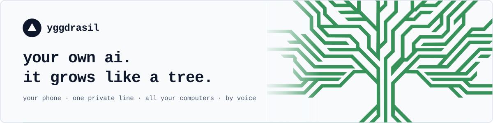
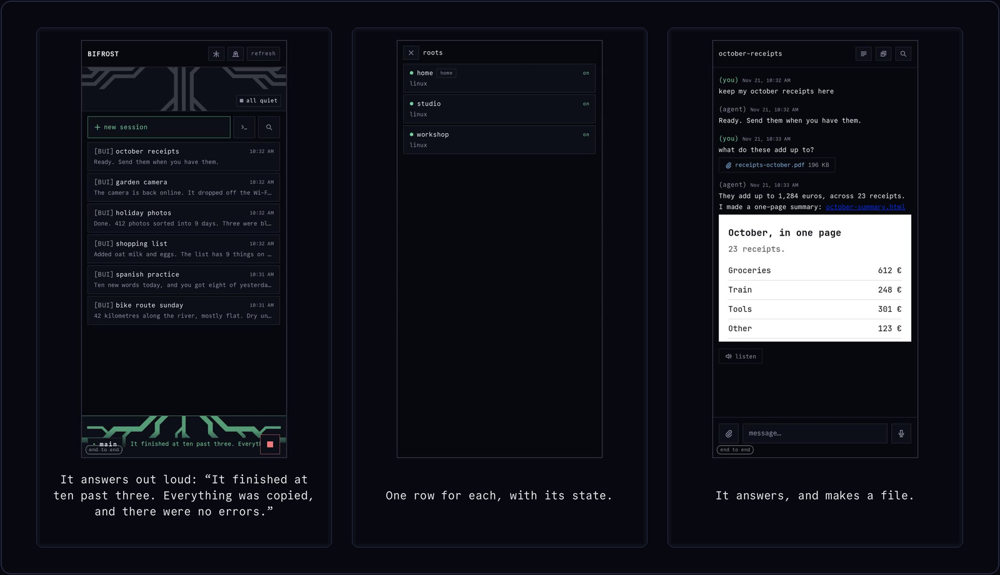
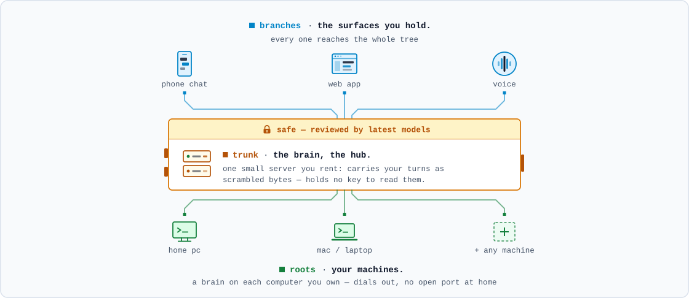

<p align="center">
  <picture>
    <source media="(prefers-color-scheme: dark)" srcset="./docs/readme/hero-dark.svg">
    
  </picture>
</p>

<p align="center">
  <a href="#quick-start">Quick start</a> ·
  <a href="https://github.com/veraldar/yggdrasil/releases">Releases</a> ·
  <a href="./SECURITY.md">Security</a> ·
  <a href="#documentation">Docs</a> ·
  <a href="https://veraldar.org">veraldar.org</a>
</p>

<p align="center">
  <a href="https://github.com/veraldar/yggdrasil/releases/latest"></a>
  <a href="./LICENSE"></a>
  
  
</p>

**yggdrasil** is a personal AI that lives on the machines you own — all of them, whatever they are — and comes with you on your phone. Talk or type from anywhere through one private line you control: your computers do the work on your real files and real programs, and answer out loud. Nothing in the middle can read your messages, files, or voice. You own all of it.

<p align="center">
  
  <br>
  <sub>Real screens from Bifrost — voice, every computer in one list, and files both ways. <a href="https://veraldar.org/#films">Watch the 80-second film with sound on veraldar.org.</a></sub>
</p>

## One tree across every machine you own

Not an app in someone else's cloud — one tree that spreads across the computers you own. Every computer you add becomes another **root**, one small server you rent is the **trunk** that carries encrypted bytes without holding a key, and **Bifrost** on your phone is the **branch** in your hand. Your computers dial out to the trunk, so nothing at home ever opens an inbound port.

<p align="center">
  <picture>
    <source media="(prefers-color-scheme: dark)" srcset="./docs/readme/tree-dark.svg">
    
  </picture>
</p>

```text
$ tree veraldar
veraldar/              the world: all your trees                        → veraldar.org
└─ yggdrasil/          the tree: your computers, working for you        (this repository)
   ├─ root/            the brain on each computer (Rust binary `yggdrasil`)
   │  ├─ extensions/   isolated plugins outside the core (such as `librarian` memory)
   │  └─ install/      home and multi-machine installers (`install.sh`, `join.sh`)
   ├─ trunk/           your private line: small server you rent (`bifrost-net`)
   └─ branch/          bifrost, the phone app (Next.js PWA) + local voice worker
```

## What yggdrasil gives you

- **Private by architecture, not by promise.** Your files, model keys, and speech stay on your machines. After scanning a pairing QR code, phone-to-home data rides a DTLS-pinned WebRTC channel straight to your home computer, and computer-to-computer calls travel inside userspace WireGuard (`boringtun` + `smoltcp`) — the trunk only forwards scrambled bytes it cannot read.
- **By voice, from anywhere.** Hold to speak or go hands-free. Speech recognition and text-to-speech run locally on your own hardware (CPU via `sherpa-onnx`, or MLX on a Mac on your LAN), with barge-in echo filtering and spoken playback controls (`stop`, `pause`, `faster`, `slower`).
- **One conversation, work across every computer.** Talk or type to `MAIN`; it answers quick questions directly, starts role-scoped child sessions (`build`, `fix`, `research`, `review`, `marketer`, `lead`) on any computer in your tree, and reports back when work finishes or needs a decision.
- **Your model subscriptions — or models at home.** Works with the AI subscriptions and APIs you already pay for (OpenAI, Anthropic, OpenRouter, Z.ai, and coding tools such as Claude Code, Antigravity, OpenCode, and Codex) — or point it at Ollama, `llama.cpp`, or vLLM at home so nothing leaves your network at all.
- **Terminal sessions, both ways.** Watch active terminal conversations from your phone, send input into `tmux` or background runs (including answering prompts), or continue a closed terminal session through the brain with single-writer safety.
- **Files both ways & searchable memory.** Attach PDFs, images, or files from your phone, open generated HTML previews right in the app, and search across all your sessions with the isolated `librarian` SQLite FTS5 extension.
- **Signed releases & instant revocation.** Every installer verifies the release's signed `SHA256SUMS` against [RELEASE-KEY.pub](./RELEASE-KEY.pub) before running anything. Revoke a lost phone — or every device at once — from `/devices` or the terminal in about a second.
- **Built to be shaped — skins and extensions.** Eight themes, editable roles, and process-isolated extensions (`root/extensions/`) ship today. Full **skins** (swapping the whole face — a library, a character, a game world) and community **extensions** are next, not shipped yet.

## Quick start

Each machine runs one script from a signed release (`v0.9.1`). No Docker, no compilers, no account with us. Secrets (your model key and connect line) are pasted interactively and never typed on a command line.

1. **Set up your private trunk** *(optional — needed for remote access and phone voice)*

   On a small Linux VPS (1 CPU / 512 MB, Debian 11+ or Ubuntu 20.04+, ports 80 and 443 open, DNS pointed at it):

   ```bash
   curl -fsSLO https://github.com/veraldar/yggdrasil/releases/download/v0.9.1/trunk.sh
   sudo bash trunk.sh --name trunk.example.org
   ```

   Installs the relay, sets up a Let's Encrypt certificate, firewall, and automatic security updates, and prints one connect line for step 2. Already running a website on port 443? See [docs/own-trunk.md](./docs/own-trunk.md).

2. **Install on your home computer** *(Linux `x86_64`, Debian 11+ / Ubuntu 20.04+ / Arch, no `sudo` needed)*

   ```bash
   curl -fsSLO https://github.com/veraldar/yggdrasil/releases/download/v0.9.1/install.sh
   bash install.sh --trunk
   ```

   Paste the connect line when asked, pick your model provider (or a local model), and let it start the systemd user services. *Trying it on home Wi-Fi only, without a VPS? Run `bash install.sh` without `--trunk`.*

3. **Pair your phone**

   ```bash
   bash install.sh pair
   ```

   Scan the QR code with your phone camera and add Bifrost to your home screen. No app store.

4. **Add your other computers** *(optional)*

   On another **Linux** machine or **Apple-silicon Mac** (prebuilt signed binaries):

   ```bash
   curl -fsSLO https://github.com/veraldar/yggdrasil/releases/download/v0.9.1/join.sh
   bash join.sh --hub https://trunk.example.org
   ```

   On **Windows 10/11 (beta)**: download [`Veraldar-Setup-0.9.1.exe`](https://github.com/veraldar/yggdrasil/releases/download/v0.9.1/Veraldar-Setup-0.9.1.exe) from the [v0.9.1 release](https://github.com/veraldar/yggdrasil/releases/tag/v0.9.1) — sets up WSL2 if needed, joins your trunk, and shows a code to approve on your phone.

   Pick **Same as the home root** to share your home model config over the encrypted WireGuard link, or choose a separate provider. `--uninstall` cleanly reverses any step.

## Documentation

| To | Read |
| --- | --- |
| Install at home, update, or troubleshoot | [Home & multi-machine install](./root/install/README.md) · [Backup](./docs/backup.md) |
| Run your own trunk on a VPS | [Your own trunk](./docs/own-trunk.md) |
| Check security, trust boundaries & revocation | [Security model](./SECURITY.md) · [Pairing spec](./docs/spec-pairing.md) · [Multi-root join spec](./docs/spec-join.md) |
| Configure voice & extensions | [Voice & TTS](./docs/tts-voice.md) · [Extensions protocol](./root/extensions/README.md) · [Plugins](./docs/plugins.md) |
| Understand the architecture & releases | [Repo map](./docs/REPO-MAP.md) · [Coordinator model](./root/ROOT-COORD.md) · [Changelog](./VERSIONS.md) |

## Honest scope & verification

- **What it does not do yet:** Built for one owner per tree (no multi-user accounts). On plain LAN HTTP without a trunk, browsers block the phone microphone (typing and hearing replies work; speaking requires HTTPS). The trunk still serves the web app HTML/JS and handles initial pairing before the pinned WebRTC channel takes over — see [SECURITY.md](./SECURITY.md) for the full trust boundary. Windows (`Veraldar-Setup-0.9.1.exe`, not yet code-signed) and Apple-silicon Mac joins are in beta; Intel Macs and non-`x86_64` Linux build from source (`--from-source` / `--build`).
- **How it is verified:** Deterministic network-namespace end-to-end suites in `sim/` (`sim/trunk-e2e.sh`, `sim/trunk-rtc-e2e.sh`, `sim/trunk-roots-e2e.py`, `sim/own-trunk-e2e.sh`, `sim/tree-e2e.py`, `sim/voice/suite.py`) verify QR pairing, active MITM rejection, VPS traffic inspection, ~1 s revocation, and voice barge-in alongside `cargo test` (`root/`, `trunk/`) and Playwright e2e tests (`branch/`).

## License

Built in Switzerland. Licensed under [AGPL-3.0](./LICENSE) — copyleft including network use: modified versions offered as a network service must make their source code available. Talking to yggdrasil over its API does not make your client a derivative work.

Attributions: the web app in `branch/` derives from [livekit-examples/agent-starter-react](https://github.com/livekit-examples/agent-starter-react) (MIT, see [branch/LICENSE](./branch/LICENSE)); icons from [pixelarticons](https://github.com/halfmage/pixelarticons) (MIT).
